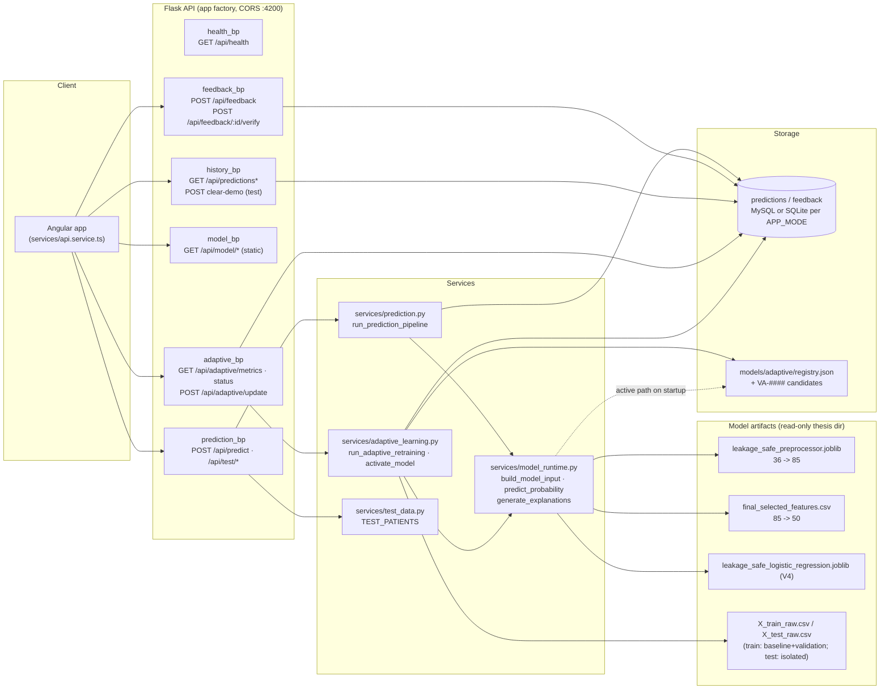
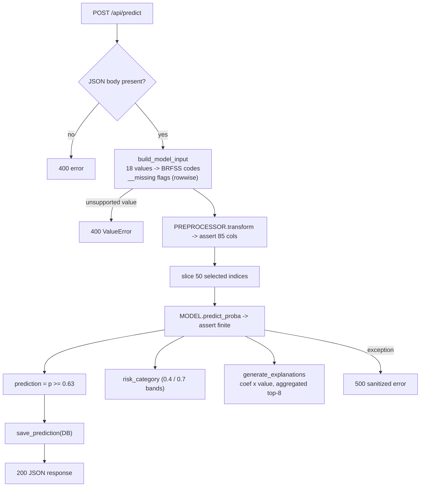

# System Architecture Report — Adaptive AI System for Diabetes Prediction

**Thesis:** Development of an Adaptive AI System for Diabetes Prediction through Reinforcement Learning
**Backend inspected:** `D:\MSc\Final_Thesis_Projects\backend` (checkpoint commit `4c0879e`)
**Model:** Logistic Regression, BRFSS 2021, 50 selected processed features, threshold 0.63
**Status of evidence:** every claim below was traced through executable source code (imports, function calls, SQL DDL). Behaviour is marked *Confirmed*, *Inferred*, or *Not implemented*.

---

## 1. Executive summary

The backend is a Flask REST API (application factory in `app/__init__.py`) serving an Angular client. It performs diabetes-risk prediction with a trained scikit-learn Logistic Regression (`leakage_safe_logistic_regression.joblib`) over a 50-feature pipeline (18 raw BRFSS 2021 predictors + 18 rowwise `__missing` flags → 85 preprocessed → 50 selected). It persists predictions and human feedback in a mode-isolated SQL database (SQLite or MySQL) and implements a **feedback-gated, supervised incremental-retraining workflow** — not reinforcement learning: user agree/disagree and a `reward` field are stored as descriptive metadata only; the only supervised labels come from `feedback.verified_label`, written solely through a reviewer verification route. Candidate models are trained by `sklearn.base.clone` of the active estimator, evaluated on a deterministic validation split of the *training* partition (never the frozen test set), gated by quality checks, registered as `VA-####` candidates, and activated only through a fail-closed, approval-required, TEST-MODE-blocked `activate_model()`. No reinforcement-learning machinery (environment, policy, discounting, reward-based parameter update) and no automatic model replacement exists anywhere in the code.

## 2. Verified component inventory

| Component | File | Key symbols | Responsibility | Status |
|---|---|---|---|---|
| Entry point | `backend/app.py` | `app = create_app()` | Dev server on :5000 | Confirmed |
| App factory | `app/__init__.py` | `create_app()` | CORS (:4200), registers 6 blueprints | Confirmed |
| Configuration | `app/config.py` | `APP_MODE`, `DB_ENGINE`, artifact paths, `PREDICTION_THRESHOLD`, adaptive floors | Env-driven config; explicit per-mode DB mapping; startup failure on missing MySQL vars | Confirmed |
| Static metadata/mappings | `app/constants.py` | `FEATURE_MAPPINGS`, `FRONTEND_TO_BRFSS`, `MODEL_INFO`, `OPTIMIZED_THRESHOLD` | Human-readable→BRFSS code mapping; static thesis metrics | Confirmed |
| Health blueprint | `app/routes/health.py` | `GET /api/health` | Mode/status probe | Confirmed |
| Prediction blueprint | `app/routes/prediction.py` | `POST /api/predict`; `GET /api/test/cases`; `POST /api/test/predict` (test-only) | Request validation envelope; shared real/test pipeline | Confirmed |
| Feedback blueprint | `app/routes/feedback.py` | `POST /api/feedback`; `POST /api/feedback/<id>/verify` | Feedback storage; **only** verified-label write path | Confirmed |
| Model blueprint | `app/routes/model.py` | `GET /api/model/{status,versions,comparison}` | **Static** narrative metadata (no artifact reads) | Confirmed (static) |
| Adaptive blueprint | `app/routes/adaptive.py` | `GET /api/adaptive/metrics`; `GET /api/adaptive/status`; `POST /api/adaptive/update` (403 in test) | Guarded candidate-cycle trigger; sanitised registry status | Confirmed |
| History blueprint | `app/routes/history.py` | `GET /api/predictions[/<id>]`; `POST /api/predictions/clear-demo` (test-only) | Read-only history; test-only demo cleanup | Confirmed |
| Prediction service | `app/services/prediction.py` | `run_prediction_pipeline`, `get_risk_category` | Orchestrates input→probability→threshold→explanations→persist | Confirmed |
| Model runtime | `app/services/model_runtime.py` | `_load_artifacts`, `build_model_input`, `add_missingness_flags`, `_transform_selected`, `predict_probability`, `generate_explanations`, `_resolve_model_path` | Startup artifact validation; BRFSS mapping; rowwise missingness flags; inference; coefficient explanations | Confirmed |
| Adaptive service | `app/services/adaptive_learning.py` | `get_eligible_feedback`, `build_candidate_dataset`, `_train_fit_validation_indices`, `load_baseline_sample`, `load_validation_set`, `train_candidate_model`, `assess_candidate_quality`, `evaluate_candidate_model`, `compare_models`, `create_model_version`, `activate_model`, `reject_model`, `run_adaptive_retraining` | Full guarded candidate lifecycle | Confirmed |
| Database | `app/database.py` | `_connect`, `_migrate`, DDL `predictions`, `feedback` | All persistence; SQLite/MySQL engines | Confirmed |
| Test fixtures | `app/services/test_data.py`, `test_data/test_patients.json` | `TEST_PATIENTS` | 5 synthetic cases through the production pipeline | Confirmed |
| Frontend client | `diabetes-ai-app/src/app/services/api.service.ts` | `ApiService` | Angular HttpClient for all endpoints | Confirmed |
| Adaptive registry | `models/adaptive/registry.json` + `models/adaptive/VA-*` | — | `active_version`, `active_model_path`, candidate statuses | Confirmed |
| Test suites | `test_model_integration.py`, `test_adaptive_hardening.py`, `test_activation_safety.py`, `test_adaptive_service.py`, `test_phase4_integration.py`, `test_adaptive_metrics.py`, `test_backend.py` | script-style assertion suites | 23 + 27 + 14 + 26 + 23 + 10 checks, all passing as executed | Confirmed |

**Not implemented (confirmed absent):** authentication/authorisation (the verify route's docstring flags this explicitly); a dedicated rollback function; automatic acceptance policy; any RL algorithm.

## 3. Prediction workflow

`POST /api/predict` (`app/routes/prediction.py:predict`, lines 66–82) → JSON body required (400 otherwise) → `features = data.get("features", data)` → `run_prediction_pipeline(features)` (`app/services/prediction.py:22`):

1. `build_model_input(features)` — 18 frontend keys → BRFSS codes via `FEATURE_MAPPINGS`/`FRONTEND_TO_BRFSS`; unsupported present values → `ValueError` → HTTP 400; missing keys → `NaN` with `{col}__missing = 1` (training-time rowwise logic); output `DataFrame(1×36)` in exact `INPUT_COLUMNS` order.
2. `predict_probability` — `PREPROCESSOR.transform` (width asserted == 85) → `processed[:, SELECTED_INDICES]` (50) → `MODEL.predict_proba(...)[:, 1]`; non-finite → `RuntimeError`.
3. Binarization: `prediction = 1 if probability >= OPTIMIZED_THRESHOLD` (0.63, env `DIABETES_THRESHOLD`). **Distinct from risk bands** (`get_risk_category`: ≥0.7 Higher, ≥0.4 Moderate, else Lower).
4. Explanations: `generate_explanations` — per-feature `coef × value`, aggregated back to raw BRFSS columns (skips `*_missing` features), sorted, top-8, with static prose. Associational contributions, not causal claims.
5. Persistence: `database.save_prediction(...)` (JSON text columns).
6. Response: `prediction, probability (4dp), risk_category, model_version, threshold, prediction_id, explanations[], mode`. Unexpected exceptions → sanitized 500 (`{"error": "Prediction failed."}`) with server-side logging only.

## 4. Feedback and adaptive-learning workflow

**Feedback:** `POST /api/feedback` → `reward = 1/-1` stored as metadata; `verified_label=NULL`, `adaptive_processed=0`. **Verification:** `POST /api/feedback/<id>/verify` → `_VERIFY_OUTCOMES` (`diabetes`→1, `no_diabetes`→0, `unable_to_verify`→NULL clears label) → `set_verified_label()` — the single trusted label write path; response notes eligibility without triggering training.

**Adaptive cycle:** `POST /api/adaptive/update` (403 in TEST MODE) → `adaptive_learning.run_adaptive_retraining()`:
1. `get_eligible_feedback()` — verified, unprocessed rows only.
2. `build_candidate_dataset` — join to stored prediction features; rebuild inputs via the production 36→85→50 path; record class counts.
3. Minimum-data floors (defaults 50 total / 20 per class; env-configurable) → `skipped` before any fit or persistence.
4. `train_candidate_model` — `clone(MODEL)` fitted on `vstack(load_baseline_sample(5000), feedback)`; baseline from the fit partition of `X_train_raw.csv` only.
5. `assess_candidate_quality` on validation data — both classes, finite in-range probabilities, non-constant probabilities, non-zero coefficients, convergence info. Failure → `candidate_invalid` (never persisted; feedback stays unprocessed).
6. `compare_models` on `load_validation_set` (stratified 20%, RS=42, disjoint from fit), identical X/y/threshold for active and candidate; pre-registered `ACCEPTANCE_CRITERIA` attached.
7. `create_model_version` — persists `models/adaptive/VA-####/{model.joblib, metadata.json}` + registry entry `status:"candidate"`; **only then** `mark_feedback_processed`.
8. Activation: `activate_model(version, approved_by)` — internal service call, **no HTTP route**; blocked in TEST MODE; approval string required; registry status must be exactly `"candidate"`; `metadata.json.quality_gates` must exist, parse, and have `valid is True` and not `degenerate` (fail-closed). On success the previous candidate is archived and `active_model_path` switches (effective on next process start). `reject_model` is the manual negative path.

## 5. Model lifecycle and safety controls

Startup: `model_runtime` import → path resolution (registry `active_model_path` if present, else frozen thesis model) → strict validation (36-input contract, 85 width, 50 selection, unique names, `n_features_in_` match) → process-wide singletons. Lifecycle: thesis baseline V4 (active) → candidate VA-#### (never auto-accepted) → manual activation/rejection with audit metadata. Safety: per-mode isolated databases; TEST MODE blocks update/clear-demo/activation; sanitised 500s; no writes outside `models/adaptive/`; frozen thesis artifacts read-only. Dedicated rollback is **not implemented** (manual registry edit would be required).

## 6. Mermaid system architecture diagram

The dashed arrow is the only one-time indirection (registry lookup at process start). All solid arrows correspond to direct imports or function calls verified in source.

## 7. Mermaid prediction workflow diagram

## 8. Thesis-ready text

### 4.2 System architecture

> The system is implemented as a layered web application comprising an Angular single-page client and a Flask REST API backend. The backend follows an application-factory structure in which six blueprints expose health, prediction, feedback, model-metadata, adaptive-learning, and prediction-history endpoints. Prediction requests are validated and mapped from human-readable assessment categories onto the original BRFSS 2021 survey codes, augmented with deterministic row-wise missingness indicators, and transformed by the saved preprocessing pipeline (36 → 85 features) and the fitted 50-feature selection before inference by the trained logistic-regression model. The predicted probability is binarised at a validation-selected threshold (0.63) and annotated with descriptive risk bands (0.40 and 0.70), coefficient-based feature contributions, and persisted with its inputs in the operational database.
>
> Human feedback is collected for every prediction and carries an agree/disagree-derived reward that is retained solely as descriptive metadata. Supervised labels enter the system exclusively through an explicit reviewer verification endpoint, which records a verified clinical outcome on the corresponding feedback record. The adaptive-learning subsystem consumes only verified, previously unprocessed labels, constructs a training batch in conjunction with a deterministic baseline sample drawn from the training partition, and trains a candidate model by cloning the active logistic-regression estimator. Candidates are subjected to minimum-data safeguards, quality gates (non-degenerate probabilities, valid coefficients, class coverage) and evaluation on a deterministic stratified validation split of the training partition; the final held-out test set is never used. Candidate models are versioned beneath a registry directory as candidates only. Model activation is fail-closed, requires explicit reviewer approval, is disabled entirely in test mode, and archives the superseded candidate. The architecture therefore implements a *feedback-gated supervised incremental-retraining* design with conservative safety controls, rather than an automated reinforcement-learning loop.

### 4.2.1 Prediction workflow

> On receipt of a prediction request, the API validates the JSON envelope and feature values (HTTP 400 on missing or unsupported values), constructs a one-row input frame containing the eighteen source predictors and their eighteen missingness flags, and applies the saved scikit-learn preprocessing pipeline, asserting an 85-feature intermediate representation. The resulting vector is restricted to the fifty selected features and passed to the logistic-regression model to obtain the diabetes probability. The model prediction is derived by comparison with the configured classification threshold (0.63), independently of the descriptive risk categories computed from the probability. Feature contributions are computed as coefficient-times-value products, aggregated back to their source variables and returned as the top-ranked explanation factors. The prediction, its inputs and metadata are persisted to the predictions table, while unexpected errors are logged server-side and returned as a sanitised HTTP 500 response.

### Figure caption

> **Figure 4.x — Layered architecture of the adaptive diabetes-risk prediction system.** Solid arrows denote call paths confirmed in source code; the dashed arrow marks the one-time activation lookup performed at process start-up. Adaptive evaluation consumes only the training partition's fit/validation split; the frozen test set is isolated to thesis evaluation.

## 9. Traceability table

| Diagram component | Source file | Supporting functions |
|---|---|---|
| Angular client | `diabetes-ai-app/src/app/services/api.service.ts` | `predict`, `submitFeedback`, `verifyOutcome`, `adaptiveUpdate`, … |
| prediction_bp | `app/routes/prediction.py` | `predict`, `get_test_cases`, `test_predict` |
| feedback_bp | `app/routes/feedback.py` | `feedback`, `verify_feedback` |
| model_bp (static) | `app/routes/model.py` | `model_status` / `model_versions` / `model_comparison` |
| adaptive_bp | `app/routes/adaptive.py` | `adaptive_metrics`, `adaptive_update`, `adaptive_status` |
| history_bp | `app/routes/history.py` | `prediction_history`, `prediction_detail`, `clear_demo_predictions` |
| health_bp | `app/routes/health.py` | `health` |
| Prediction service | `app/services/prediction.py` | `run_prediction_pipeline`, `get_risk_category` |
| Model runtime | `app/services/model_runtime.py` | `_load_artifacts`, `build_model_input`, `_transform_selected`, `predict_probability`, `generate_explanations`, `add_missingness_flags` |
| Adaptive service | `app/services/adaptive_learning.py` | full list in §2 |
| Database | `app/database.py` | `save_prediction`, `save_feedback`, `set_verified_label`, `get_verified_feedback`, `mark_feedback_processed`, … |
| Artifacts | thesis `results_leakage_safe/` | loaded via `joblib` in `model_runtime._load_artifacts` |
| Registry/candidates | `models/adaptive/registry.json` + `VA-*` | `_load_registry`, `create_model_version`, `activate_model`, `reject_model` |

## 10. Unverified assumptions and implementation gaps

1. **Not reinforcement learning** — no environment, policy gradient, or reward-gradient update exists; `reward` is stored but never consumed by training. Confirmed by tracing `run_adaptive_retraining`.
2. **Rollback** — no `rollback()` function; activation archives only the previous candidate, and V4 is absent from `registry["versions"]`, so the thesis baseline cannot be restored through the API.
3. **No auth** — the verification endpoint is openly callable in this prototype (its docstring acknowledges this).
4. **Startup active-path resolution** — `_resolve_model_path` trusts any existing path in the registry; compatibility with the current 50-feature selection is enforced only implicitly by the `n_features_in_` assertion at import.
5. **Static model endpoints** — `/api/model/*` return hard-coded narrative metadata from `constants.py`, not computed values; the thesis should not present them as live measurements.
6. **Dual runtime loading** — artifacts load at import; activation takes effect only on process restart (documented in the `activate_model` response).
7. **Legacy candidate data** — Va-0006/VA-0007 hold registry status `candidate` with pre-hardening metadata lacking quality gates; activation is fail-closed against them, but formally rejecting them would tidy the registry.
8. **Unexercised path** — production-mode traffic was reasoned from `APP_MODE` logic only; no live production deployment was tested during this analysis.
